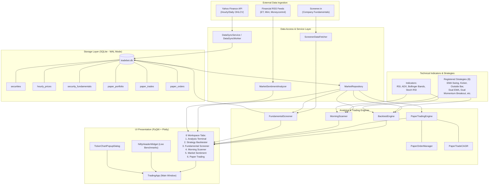

# TradeBot: Quantitative Algorithmic Trading & Analytics Studio

A modular desktop algorithmic trading management studio, quantitative backtesting engine, and virtual paper trading suite engineered specifically for the Indian equity market (**National Stock Exchange - NSE**: Nifty 50, Nifty 200, and sectoral benchmark indices).

TradeBot integrates end-to-end quantitative trading workflows: from automated historical market data ingestion and dual-source fundamental analysis, to rule-based multi-strategy backtesting, pre-market morning scanning, macro sentiment analysis via RSS feeds, and a high-performance **PyQt6 + Plotly** desktop terminal.

---

## Table of Contents

- [Core Features](#core-features)
- [System Architecture](#system-architecture)
- [Repository Structure](#repository-structure)
- [Database Schema & Data Pipeline](#database-schema--data-pipeline)
- [Strategy Catalog](#strategy-catalog)
- [Technical Indicators](#technical-indicators)
- [Risk Management & Order Mechanics](#risk-management--order-mechanics)
- [Installation & Setup](#installation--setup)
- [Running TradeBot](#running-tradebot)
  - [Desktop GUI Terminal](#desktop-gui-terminal)
  - [CLI Showcases & Command-Line Tools](#cli-showcases--command-line-tools)
- [Guide for AI Tools & Autonomous Agents](#guide-for-ai-tools--autonomous-agents)
- [Code Style & Contribution Guidelines](#code-style--contribution-guidelines)

---

## Core Features

- **Interactive Desktop Management Studio (PyQt6 + Plotly)**:
  - 6 specialized tabs: *Analysis Terminal*, *Strategy Backtester*, *Fundamental Screener*, *Morning Scanner*, *Market Sentiment*, and *Paper Trading*.
  - Persistent real-time **Nifty Live Benchmark Header** streaming live quotes, net/percentage changes, day high/low gauges, and Indian Standard Time (IST) market clock.
  - Interactive **Ticker Chart Popup Dialog** with period switches (1M, 3M, 6M, 1Y, All), EMAs (20/50), volume subplot, and return summaries.
- **Event-Driven Backtesting Engine (`BacktestEngine`)**:
  - Chronological multi-asset portfolio simulation across all 50 active equities.
  - Realistic next-day open entries/exits with intraday high/low stop-loss and take-profit target hits.
  - Dynamic capital allocation (default 10% per position) and strict 1% risk-per-trade position sizing.
  - Comprehensive metrics: Total PnL, Win Rate, CAGR, Profit Factor, R-Multiple, and Max Drawdown.
- **Virtual Paper Trading & Order Management (`PaperTradingEngine`, `PaperOrderManager`)**:
  - Virtual portfolio seeded with ₹5,00,000 cash balance.
  - Limit orders (`<= buy_price`) and market orders (CMP) with NSE trading window awareness (09:15 to 15:30 IST).
  - Pre-market/post-market pending order queue with automatic opening CMP fill evaluation.
  - Position enhancements: live stop-loss/target editing, partial quantity selling (tranche close), and trailing stops.
  - Calendar-day trade holding duration and annualized Compound Annual Growth Rate (CAGR) analytics.
- **Pre-Market Morning Scanner (`MorningScanner`)**:
  - Evaluates active positions against previous close to detect required profit targets or stop-loss triggers.
  - Scans all equities with 3-6 months indicator warm-up across registered strategies.
  - Conservative **Least-Profit Confluence Selection**: when multiple strategies trigger a BUY, selects the setup with the lowest profit target to establish conservative Stop Loss and Take Profit levels.
- **Dual-Source Fundamental Screener (`FundamentalScreener`, `ScreenerDataFetcher`)**:
  - Direct web scraping of [Screener.in](https://www.screener.in) for financial metrics (Market Cap, P/E, PEG, D/E, ROCE, ROE, Institutional Holding) combined with Yahoo Finance fallback.
  - Calculates 252-day historical Beta relative to Nifty 50 (`^NSEI`) and 252-day average trading volume.
- **Macro Catalyst & News Sentiment Analyzer (`MarketSentimentAnalyzer`)**:
  - Ingests financial RSS feeds (The Economic Times, Livemint, Moneycontrol, Google News India).
  - Regex-driven catalyst classifier for high-impact market events: War/Geopolitical Conflict, Union Budget & Fiscal Measures, RBI/SEBI Regulatory Policies, Market Crashes/Shocks, and All-Time High Rallies.
- **Background Synchronization Service (`DataSyncService`, `DailyDataUpdater`)**:
  - Multi-threaded non-blocking incremental price syncing using `yfinance` in SQLite Write-Ahead Logging (WAL) mode.
  - Synthetic constituent volume aggregation for Indian benchmark indices.

---

## System Architecture



---

## Repository Structure

```
TradeBot/
├── .agents/
│   ├── rules/
│   │   └── code-style-guide.md       # PEP 8, comment conventions, main.py extension rule
│   └── workflows/
│       └── generate-unit-tests.md    # Test generation conventions
├── config/
│   ├── __init__.py                   # Centralized configuration exports
│   ├── indices.py                    # Target NSE benchmark & sectoral index symbols
│   └── settings.py                   # Paths, IST timezone, risk defaults, market open logic
├── data/
│   ├── sync_settings.json            # Synchronization preferences and last run info
│   └── tradebot.db                   # Main SQLite database (WAL mode)
├── resources/
│   ├── ind_nifty50list.csv           # Master constituent list for Nifty 50
│   └── ind_nifty200list.csv          # Master constituent list for Nifty 200
├── strategies/
│   ├── __init__.py                   # STRATEGY_REGISTRY mapping and exports
│   ├── base_strategy.py              # Abstract BaseStrategy interface
│   ├── adx_ema_swing.py              # Linda Raschke's ADX + 20 EMA Swing (The Holy Grail)
│   ├── bollinger_stoch_rsi.py        # Bollinger Bands + Stoch RSI Mean Reversion
│   ├── bullish_kicker.py             # Bullish Kicker Candlestick Reversal
│   ├── bullish_outside_bar.py        # Bullish Outside Bar (Engulfing) Reversal
│   ├── dual_moving_average_adx.py    # 20/50 EMA Crossover with ADX Volatility Filter
│   ├── moving_average_stochastic.py  # 200 MA Trend + Stochastic (8,3,3) Oversold
│   ├── nifty_dual_momentum_breakout.py # Hourly 200 EMA + 20D High Breakout (1:2 RRR)
│   └── rsi_bull_trend_pullback.py    # 200 SMA Bull Trend + RSI 40 Pullback
├── ui/
│   ├── __init__.py                   # UI component exports
│   ├── backtest_tab.py               # Tab 2: Strategy Backtester view and controls
│   ├── data_sync_widget.py           # Sidebar data sync progress and trigger widget
│   ├── fundamental_screener_tab.py   # Tab 3: Screener table and benchmark metrics
│   ├── market_sentiment_tab.py       # Tab 5: RSS headlines and macro catalyst cards
│   ├── morning_scanner_tab.py        # Tab 4: Pre-market buy/sell signals table
│   ├── nifty_header_widget.py        # Persistent top bar streaming Nifty quotes & IST time
│   ├── paper_trading_dialogs.py      # Modals: Edit SL/Target, Partial Position Sale
│   ├── paper_trading_tab.py          # Tab 6: Virtual portfolio, order entry, live trades
│   ├── ticker_chart_popup.py         # Modal 3-month interactive candlestick popup
│   └── trading_app.py                # Main QMainWindow integrating all views and tabs
├── adx_indicator.py                  # ADX, +DI, -DI, and ATR indicator calculations
├── back_test_engine.py               # Multi-asset portfolio backtester with 1% risk rules
├── bollinger_bands.py                # Bollinger Bands (Upper, Middle, Lower, %B, Bandwidth)
├── daily_data_updater.py             # Incremental price updater via yfinance
├── data_sync_service.py              # Background QThread singleton data synchronization
├── entry_stop_loss_validator.py      # Invariant validator ensuring StopLoss < EntryPrice
├── fundamental_screener.py           # Screener evaluating PEG, Beta, Debt/Equity, Volume
├── historical_data_loader.py         # Initial database creation and 730d price seeding
├── main.py                           # CLI showcase dispatcher & GUI application launcher
├── market_repository.py              # SQLite repository for securities, OHLCV, and fundamentals
├── market_sentiment_analyzer.py      # RSS feed parser and macro event catalyst detector
├── morning_scanner.py                # Pre-market morning signal scanner and confluence engine
├── paper_order_manager.py            # Limit order queue and NSE market open executor
├── paper_trade_cagr.py               # Annualized CAGR calculations for trades and portfolio
├── paper_trading_engine.py           # Virtual paper trading engine with SQLite state
├── pyproject.toml                    # Ruff and Pylint configuration
├── rsi_indicator.py                  # Relative Strength Index (Wilder's exponential smoothing)
├── screener_data_fetcher.py          # Screener.in HTTP client and HTML parser
└── stoch_rsi_indicator.py            # Stochastic RSI (%K, %D) momentum indicator
```

---

## Database Schema & Data Pipeline

The project uses an embedded SQLite database (`data/tradebot.db`) configured with **WAL (Write-Ahead Logging)** mode to enable concurrent reads during background synchronization.

### Table Definitions

1. **`securities`**:
   - `id` (INTEGER PRIMARY KEY): Internal unique identifier.
   - `ticker` (TEXT UNIQUE): Ticker symbol (`RELIANCE.NS`, `^NSEI`).
   - `name` (TEXT): Full company or index description.
   - `asset_type` (TEXT): `'STOCK'` or `'INDEX'`.

2. **`hourly_prices`**:
   - Stores raw 1-hour OHLCV price bars. Daily bars are computed dynamically on the fly via `MarketRepository.get_daily_data()`.
   - Columns: `security_id`, `date` (`YYYY-MM-DD HH:MM:SS`), `open`, `high`, `low`, `close`, `volume`.
   - Constraint: `UNIQUE(security_id, date)`.

3. **`security_fundamentals`**:
   - Cached fundamental and benchmark metrics.
   - Columns: `security_id`, `ticker`, `updated_at`, `market_cap_cr`, `debt_to_equity`, `peg_ratio`, `beta_nsei` (252-day Beta vs `^NSEI`), `beta_yf`, `avg_volume_252`, `roe`, `institutional_ownership`, `is_passing`, `filter_details`.

4. **`paper_portfolio`**:
   - Tracks cash balances (`id = 1`).
   - Columns: `cash_balance` (defaults to ₹5,00,000.00), `initial_capital`, `updated_at`.

5. **`paper_trades`**:
   - Virtual active positions and completed trade journal.
   - Columns: `trade_id`, `timestamp`, `entry_date`, `ticker`, `side`, `entry_price`, `current_price`, `exit_price`, `quantity`, `stop_loss`, `sell_target`, `status` (`'OPEN'`, `'CLOSED'`), `realized_pnl`, `exit_timestamp`, `exit_date`, `exit_reason`.

6. **`paper_orders`**:
   - Pending limit orders and queued market orders outside trading hours.
   - Columns: `order_id`, `created_at`, `order_date`, `ticker`, `side`, `buy_price` (limit price or `None` for CMP), `stop_loss`, `sell_target`, `requested_quantity`, `status` (`'PENDING'`, `'EXECUTED'`, `'CANCELLED'`, `'REJECTED'`), `status_reason`, `executed_price`, `executed_quantity`, `executed_at`, `executed_trade_id`.

---

## Strategy Catalog

All strategies implement the abstract `BaseStrategy` interface and are registered in `strategies.STRATEGY_REGISTRY`:

| Strategy Name | Timeframe | Setup & Triggers | Stop Loss | Profit Target / Exit |
|---|---|---|---|---|
| **Moving Average + Stochastic** | Daily | Price > 200-day MA + Stochastic (8, 3, 3) %K crosses above %D in oversold zone (< 20) | 5-day swing low | Fixed 10.0% profit target |
| **Bullish Kicker Pattern** | Daily | Day $t-1$ bearish candle, Day $t$ gap-up open $\ge$ Day $t-1$ open with bullish close and volume confirmation | Low of Day $t-1$ | Fixed 10.0% profit target |
| **Bullish Outside Bar (Engulfing)** | Daily | Multi-day downtrend (6-10%), Day $t$ completely engulfs Day $t-1$, close near candle high, volume spike | Low of reversal candle (Day $t$) | Fixed 20.0% profit target or 15-day max holding time |
| **Linda Raschke ADX + 20 EMA (Holy Grail)** | Daily | 14-period ADX > 30, +DI > -DI, price retraces to touch 20 EMA, enter on breakout of touch bar high | Recent swing low | 2R target ($2 \times \text{Initial Risk}$), ADX < 30, or close below 20 EMA |
| **Dual Moving Average & Volatility Filter** | Daily | 20 EMA crosses above 50 EMA with 14-day ADX > 20 (trend strength filter) | Lowest of recent swing low or 5% buffer below entry | 1:2 Risk-to-Reward (2R) or bearish 20/50 EMA crossover |
| **RSI Pullback in Bull Trend** | Daily | Structural bull market (Close > 200 SMA), 14-period RSI dips < 40 and crosses back above 40 | Lowest of 5-day low or close below 200 SMA | RSI reaches overbought ($\ge 70$), close < 200 SMA, or 15 trading days |
| **Mean Reversion Bollinger Bands + Stoch RSI** | Daily | Price touches/closes below Lower Bollinger Band (20, 2) + Stoch RSI %K crosses %D < 20 | 1.5 ATR below setup candle low | Middle Bollinger Band (20 SMA mean) or Stoch RSI %K crosses %D > 80 |
| **Nifty Dual Momentum Breakout** | Hourly | Close > 200 EMA (1,400 hourly bars), current close > 20-day high (140 hourly bars), volume > 1.5x 20-bar volume MA | 3.5% below entry price | 7.0% target (1:2 RRR); Trailing stop moves to breakeven (entry price) at +3.5% gain |

---

## Technical Indicators

Custom vectorised mathematical implementations built on top of NumPy and Pandas:

1. **Relative Strength Index (RSI)** (`rsi_indicator.py`):
   - Implements J. Welles Wilder's exact exponential smoothing method ($\alpha = 1 / \text{period}$).
   - Handles edge cases (zero loss returns 100.0; flat price series returns neutral 50.0).
2. **Average Directional Index (ADX) & Directional Movement System** (`adx_indicator.py`):
   - Computes True Range (TR), Positive Directional Movement (+DM), and Negative Directional Movement (-DM).
   - Smoothes with Wilder's EMA to generate +DI, -DI, DX, ADX, and ATR.
3. **Bollinger Bands** (`bollinger_bands.py`):
   - Computes 20-period Middle Band (SMA), Upper Band ($+2\sigma$), Lower Band ($-2\sigma$), Bandwidth, and %B oscillator.
4. **Stochastic RSI** (`stoch_rsi_indicator.py`):
   - Measures RSI relative to its high-low range over a 14-period lookback window, smoothed into %K (3 periods) and %D (3 periods).

---

## Risk Management & Order Mechanics

### Position Sizing Formula (The 1% Rule)

For all simulated and paper trades, position size is determined by fixed percentage risk allocation:

$$\text{Risk Amount} = \text{Capital} \times \text{Risk Per Trade (1\%)}$$

$$\text{Quantity} = \left\lfloor \frac{\text{Risk Amount}}{\text{Entry Price} - \text{Stop Loss}} \right\rfloor$$

$$\text{Quantity} = \min\left(\text{Quantity}, \left\lfloor \frac{\text{Deployment Cap (₹1,00,000)}}{\text{Entry Price}} \right\rfloor, \left\lfloor \frac{\text{Available Cash}}{\text{Entry Price}} \right\rfloor\right)$$

### Invariant Stop Loss Verification

- Long positions enforce the hard invariant: $\text{Stop Loss} < \text{Entry Price}$ and $\text{Take Profit} > \text{Entry Price}$.
- If overnight gap-down breaches the structural stop, the entry execution dynamically re-anchors Stop Loss strictly 5% below actual fill price.
- Guaranteed zero **"Win (Stop Loss)"** reporting anomalies (`entry_stop_loss_validator.py`).

### NSE Market Hours & Limit Orders

- Regular NSE hours: **09:15 to 15:30 IST (Monday - Friday)** (`config.is_market_open_ist`).
- Orders submitted outside this window are automatically queued as `PENDING` in `paper_orders`.
- On market open, orders without a limit price execute at the opening CMP; limit orders execute only if $\text{Opening CMP} \le \text{Buy Price}$.

---

## Installation & Setup

### Prerequisites

- **Python**: Version 3.10 or higher (compatible up to Python 3.14).
- **Operating System**: Windows, macOS, or Linux.
- **C/C++ Build Tools / Graphics Drivers**: Required for PyQt6 and PyQt6-WebEngine.

### 1. Clone the Repository

```bash
git clone https://github.com/your-username/TradeBot.git
cd TradeBot
```

### 2. Create and Activate Virtual Environment

```bash
# Windows (PowerShell)
python -m venv .venv
.\.venv\Scripts\Activate.ps1

# Linux / macOS
python3 -m venv .venv
source .venv/bin/activate
```

### 3. Install Dependencies

```bash
pip install --upgrade pip
pip install PyQt6 PyQt6-WebEngine plotly pandas numpy yfinance beautifulsoup4 requests
```

### 4. Initialize Database & Seed Market Data

TradeBot includes a seed script that creates database tables and pulls historical hourly data (up to 730 days) for all Nifty 50 stocks and benchmark indices:

```bash
python historical_data_loader.py
```

*Note: Ingesting 730 days of hourly bars for 50+ securities takes approximately 2-4 minutes depending on network bandwidth and API rate limits.*

---

## Running TradeBot

`main.py` serves as the centralized dispatcher for launching the GUI and running CLI showcases.

### Desktop GUI Terminal

Launch the full desktop studio:

```bash
python main.py
```

---

### CLI Showcases & Command-Line Tools

Run specialized command-line showcases without launching the graphical UI:

| Command | Description |
|---|---|
| `python main.py --scanner` | Run pre-market Morning Scanner across 50 active equities (checks active position profit hits and triggers least-profit confluence BUY signals). |
| `python main.py --scanner --last-bar` | Run Morning Scanner evaluating strictly the final close bar (15:15 IST). |
| `python main.py --paper-trading` | Showcase Paper Trading Engine: portfolio state, 1% risk position sizing, active positions, and trade history. |
| `python main.py --paper-orders` | Showcase Limit Orders, pending order book queues, and simulated NSE opening bell execution. |
| `python main.py --paper-cagr` | Showcase calendar-day holding durations, trade CAGR, and overall portfolio CAGR analytics. |
| `python main.py --paper-enhancements` | Showcase interactive ticker search, trailing stop updates, and partial position sales (tranche liquidation). |
| `python main.py --backtest` | Run multi-stock portfolio backtest across all 50 stocks (10% allocation) using Moving Average + Stochastic. |
| `python main.py --cli` | Showcase Fundamental Screener metrics evaluation and technical strategy execution. |
| `python main.py --screener-fetcher --ticker=INFY.NS` | Directly query and parse fundamental metrics from Screener.in for a ticker. |
| `python main.py --sentiment` | Ingest live financial RSS feeds and run macro catalyst detection (War, Budget, Policy, Crash). |
| `python main.py --sync` | Perform incremental daily price sync for all securities in database. |
| `python main.py --entry-sl` | Execute automated test suite validating entry-based stop loss invariants across all strategies. |
| `python main.py --holy-grail` | Run Linda Raschke's ADX + 20 EMA Holy Grail swing backtester. |
| `python main.py --kicker` | Run Bullish Kicker candlestick reversal strategy backtest. |
| `python main.py --outside-bar` | Run Bullish Outside Bar (Engulfing) reversal strategy backtest. |
| `python main.py --dual-ema` | Run Dual Moving Average (20/50 EMA) & ADX volatility filter backtest. |
| `python main.py --rsi-pullback` | Run RSI Bull Trend Pullback strategy backtest. |
| `python main.py --bb-stoch-rsi` | Run Mean Reversion Bollinger Bands + Stoch RSI backtest. |
| `python main.py --momentum` | Run Nifty Dual Momentum Breakout hourly cash equity strategy backtest. |
| `python main.py --rsi` | Calculate and display current 14-period RSI status across benchmark securities. |
| `python main.py --adx` | Calculate and display current 14-period ADX, +DI, and -DI trend strength across securities. |
| `python main.py --nifty` | Launch standalone live Nifty benchmark ticker header window. |
| `python main.py --chart-popup --ticker=TCS.NS` | Launch 3-month interactive candlestick popup chart for a specific ticker. |

---

## Guide for AI Tools & Autonomous Agents

When working with or extending the TradeBot codebase, AI assistants and automated coding tools must observe the following architectural invariants:

### 1. The `main.py` Entry Point Rule
- **Never implement business logic or complex algorithms directly inside `main.py`**.
- New features, indicators, strategies, or dialogs must be authored in their dedicated modules (e.g., `feature_name.py` or within `strategies/` / `ui/`).
- To expose the feature via the CLI, write a concise `example_<feature>()` function in `main.py` and map a command-line flag in `main.py`'s `main()` argument parser to invoke it.

### 2. Strategy Implementation Protocol
- All strategies must inherit from `strategies.base_strategy.BaseStrategy`.
- Strategies must implement `name` (property) and `generate_signals(df, capital, risk_per_trade, **kwargs) -> pd.DataFrame`.
- The returned DataFrame must preserve the original index and append the standard framework columns:
  - `Signal`: `1` (Buy), `-1` (Sell), `0` (Hold).
  - `StopLoss`: Absolute price level for stop loss (must be $< \text{Entry Price}$ for long positions).
  - `TakeProfit`: Absolute price level for target profit.
  - `StopLossPct` (optional): Percentage buffer below entry price (e.g., `0.05` for 5%).
  - `TakeProfitPct` (optional): Percentage target above entry price (e.g., `0.10` for 10%).
- Register any newly implemented strategy in `strategies/STRATEGY_REGISTRY` in `strategies/__init__.py`.

### 3. Data Column Naming Conventions
- Raw OHLCV price series loaded from `MarketRepository` always use **lowercase** column names: `date`, `open`, `high`, `low`, `close`, `volume`.
- Indicator and signal columns produced by strategies use **CamelCase**: `Signal`, `StopLoss`, `TakeProfit`, `BB_Upper`, `RSI`, `ADX`.

### 4. Timezone & Market Hours
- All market schedule logic uses `config.IST_TIMEZONE` (UTC + 5:30).
- Regular trading window is strictly `09:15` to `15:30` IST on weekdays (`0` = Monday through `4` = Friday).
- Never assume UTC wall clock equals exchange market time.

### 5. Database Concurrency
- `data/tradebot.db` must always be accessed with timeouts and WAL mode (`PRAGMA journal_mode=WAL;`).
- Background workers in UI components should run inside `QThread` (e.g., `DataSyncWorker`, `NiftyLiveWorker`) to ensure UI responsiveness.

---

## Code Style & Contribution Guidelines

- **Style Guide**: Follow the [PEP 8 Style Guide](https://peps.python.org/pep-0008/).
- **Line Length**: Max 100 characters per line (configured in `pyproject.toml` for Ruff and Pylint).
- **Docstrings**: All modules, classes, and functions must have detailed Google/Sphinx style docstrings documenting arguments, return types, and exceptions.
- **Type Annotations**: Use Python standard type hints (`str`, `float`, `list[dict]`, `pd.DataFrame`, `tuple[bool, str]`).
- **Linter & Formatting**:
  ```bash
  # Check formatting and linting with Ruff
  ruff check .
  ruff format --check .
  ```
- **Unit Testing**:
  When authoring tests, place test files in a dedicated test suite with the `test_` prefix corresponding to the module name (e.g., `test_rsi_indicator.py` for `rsi_indicator.py`), per `.agents/workflows/generate-unit-tests.md`.

---

## License

This project is licensed under the MIT License - see the LICENSE file for details.

